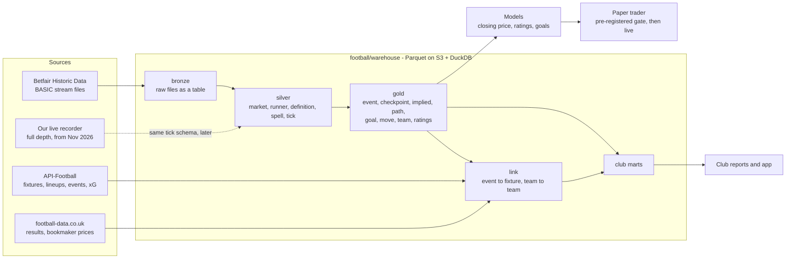

# racing² football data platform - architecture

One store of football data for two businesses: a quantitative betting model of Betfair's football markets, and
football analytics for clubs. This document is the end-to-end design, what is built, and what comes next.
Every number here was measured on the owner's 2026 Betfair download (`2026.zip`, 11 Nov 2026) unless it says
otherwise; the table and column definitions are in `docs/football_data_dictionary.md` (generated from the code).

## 1. At a glance

| | |
|---|---|
| Raw data in | 165,734 Betfair market files (match odds, over/under 2.5, Asian handicap; every country; Jan to early Nov 2026), 0 unreadable |
| Matches | 55,015 (52,635 went in play; 53,530 settled with a result) |
| Price ticks | 26.5 million (9.9 million before the off, 16.6 million in play), each stamped with the market's state |
| Teams | 10,053 Betfair team ids, one id a team across every competition |
| Tables | 2 bronze, 5 silver, gold and club marts (section 5); built end to end from the raw files in minutes |
| Checks | a quality report on every build; unit tests on every module; two independent implementations agree on the checkpoint prices; an independent census of the raw files agrees with the tables to the tick |
| Engine | Parquet on S3 (or a local folder) + DuckDB; no server, no new cost |
| Run it | `python -m football.warehouse ingest-queue`, `build`, `check`; or the `football-warehouse.yml` workflow |

## 2. What each business needs

**Betting.** The closing price is the benchmark: a bet that beats it has positive expected value before costs.
The model must forecast the move from any earlier moment to the close, on Betfair's own prices, and know how far
to trust each price (a last traded price can be hours old). It needs point-in-time data: at a decision made 60
minutes before kick-off, only what was published by then. Later: outcome pricing against the close, and in-play.

**Clubs.** The market is the best available estimate of how good a team is; results are noisy samples of it.
From the same prices: each team's strength on one global scale, results against expectation, the size of a
league's quality gap to another, goal timing and game state, and (with API-Football's lineups and events) what
the market thinks of a team with and without a player.

Both need the same foundation: every price, typed and trustworthy, tied to matches and teams.

## 3. End to end

Bronze is immutable and everything else is rebuilt from it. A build is idempotent: a partition is rebuilt only
when the fingerprint of its inputs or the code's version changed.

## 4. Decisions

| Decision | Choice | Why | Not chosen |
|---|---|---|---|
| Storage | Parquet on S3, hive-partitioned by year and month, one file a partition, sorted by key, zstd | Already our store; columnar; cheap; any tool reads it | A database server to run and pay for |
| Engine | DuckDB 1.5.6 (pinned) over the files in place | SQL, window functions, as-of joins, hundreds of millions of rows on one machine, no server | ClickHouse / Timescale: not needed at this size |
| Table format | Plain Parquet + a manifest a table (rows, bytes, input fingerprint, code version) | One writer (the workflow); rebuilds are cheap and exact | Iceberg / Delta / DuckLake: weight without a second writer; revisit if that changes |
| Raw files | As rows of a table (`bronze/raw`: path, hash, bytes) | No small-files problem (165,734 files become 11); queryable; hashed | 165,734 loose objects in S3 |
| Partition key | The date in the file's own path (the day the market settled) | Bronze, silver and gold line up one to one; incremental builds are trivial | Kick-off month: 0.4 percent of markets settle in another month |
| Checkpoints | Minutes before the scheduled kick-off (4320 ... 1, and 0 = the close) | Known in advance, so training matches what a trader would see | The actual kick-off: not known until it happens |
| Prices at checkpoints | The last price at or before the moment, with its age and its book | A stale or partial book is a column, not a surprise | Interpolation |
| Transform code | Small modules, each a pure function of Arrow tables (`SPECS`, `INPUTS`, `VERSION`, `build`) | Testable without a store; the orchestrator does I/O, order and manifests | One large script |
| Team identity | Betfair's selection id of the match-odds runner | Stable across competitions: 10,053 teams in 2026 | Names (223 ids carry more than one spelling) |
| Serving to clubs | Later: pre-aggregated Parquet read by DuckDB in the app, or a small Postgres | Needs the owner's approval for any cost | Aurora now |

Aurora Serverless v2 is not used: nothing here needs a server yet, and it would cost money each month. If the
club-facing app needs row-level access control or many concurrent users, it becomes the serving database then.

## 5. The data model

Full definitions: `docs/football_data_dictionary.md`. Conventions: times UTC; prices are Betfair decimal prices;
`handicap` is 0.0 where a runner has none, so (market, selection, handicap) is always a full key.

| Layer | Table | One row is | Key | Rows (2026) |
|---|---|---|---|---|
| bronze | `bronze/raw`, `bronze/index` | a raw file (with / without its bytes) | plan_path | 165,734 |
| silver | `silver/market` | a market | market_id | 165,734 |
| silver | `silver/runner` | a runner (selection and line) with its result | market_id, selection_id, handicap | 3.9 million |
| silver | `silver/definition` | a publication of the market's state | market_id, seq | 4.4 million |
| silver | `silver/spell` | a run of constant (in play, status) | market_id, spell_no | 1.1 million |
| silver | `silver/tick` | a published last traded price, with the state then | market_id, selection_id, handicap, pt, seq | 26.5 million |
| gold | `gold/event` | a match: sides, kick-off, result, trading, closing 1X2 | event_id | 55,015 |
| gold | `gold/team` | a Betfair team | team_id | 10,053 |
| gold | `gold/checkpoint` | a runner at a checkpoint: price, age, book | market_id, selection_id, handicap, cp_min | 9.8 million |
| gold | `gold/implied` | a match at a checkpoint: chances, goal expectancies, draw premium, handicap against 1X2 | event_id, cp_min | 604,227 |
| gold | `gold/move` | a runner's move from a checkpoint to the close (the model's target) | market_id, selection_id, handicap, cp_min | 6.3 million |
| gold | `gold/path` | a runner's price path before a checkpoint (features) | market_id, selection_id, handicap, cp_min | see section 8 |
| gold | `gold/goal`, `gold/timeline` | an inferred goal; a match's inferred timeline | event_id, goal_no; event_id | see section 8 |
| gold | `gold/team_rating`, `gold/rating_gap` | a team's market-implied rating before a match; ratings against the price at a checkpoint | team_id, event_id; event_id, cp_min | see section 8 |
| gold | `gold/link`, `gold/team_link`, `gold/goal_check` | a match linked to an API-Football fixture; a team to a team; inferred goals against real ones | event_id; team_id; event_id | built in the workflow (needs S3) |
| club | `club/*` | team-match and team-season marts | see section 10 | see section 10 |

What the silver layer keeps that the old tables dropped: every price (not four marks), the market's state at each
price (in play, suspended), every state change, and the in-play half of the data (62 percent of all ticks).

## 6. Identity and linking

- **Event** = one match (Betfair's event id). 54,970 of 55,015 events have all three markets. Where an event has
  two markets of one type (279 events: Betfair voided and re-made one), the one that traded more is the event's.
- **Team** = the selection id of the side on the match-odds market.
- **Competition and season** are not in the BASIC files (only a country code, missing on 10 percent of events:
  cups and internationals). They come from linking events to API-Football fixtures by kick-off and team names,
  then mapping team ids by majority vote and linking the rest through the map (`football/warehouse/link.py`,
  run in the workflow because the fixture tables live in S3).
- **Category**: senior, women, youth or reserves, read from the sides' names (approximate).

## 7. Quality and operations

- `python -m football.warehouse check` runs the quality report and exits 1 on a failed hard check: silver built
  from the current bronze; files in = read + unreadable + superseded; keys unique (market and event ids across
  partitions too); every row's market exists; no checkpoint carries a price published after its moment; a complete
  book's chances sum to one; implied totals and supremacies in range. Soft checks (reported): unreadable share,
  result coverage, and the closing 1X2 chances against the results.
- On the 2026 data: all hard checks pass; closing chances against results on 42,439 matches with a fresh full book:
  home 0.4378 against 0.4364 realised, draw 0.2482 against 0.2502, away 0.3140 against 0.3134.
- A "price" outside Betfair's range (1.01 to 1000) is not a trade and is kept out of the tick table, counted on the
  market: 3 in 26.5 million (a void market closed at 1.0 on every runner).
- Regression against the old parser (`betfair_historic.parse_market`) on 3,000 real files, 68,117 runners: first
  price, closing price and result agree on every runner; checkpoint prices agree on 99.99 percent where the
  scheduled kick-off never moved (the old parser used a strict "before", the new one "at or before").
- An independent census of the raw files (a separate script, another parser) gives the same files, events,
  market-type counts and 26,486,637 price updates as the first silver build, 9,933,146 of them before the off.
- Tests: `tests/test_football_warehouse*.py` (hand-written stream files through the real parser; exact values).
- Workflow: `.github/workflows/football-warehouse.yml` (GitHub's runners, S3 only, nothing reaches Betfair).

## 8. Metric catalogue: what is engineered from the data

Status: **built** (in a table, tested, run on 2026) or *planned*.

| Family | Metrics | Where | Betting use | Club use |
|---|---|---|---|---|
| Price level and trust | price, age, activity so far and in the window, book completeness, book sum, normalised chance, stalest leg | `gold/checkpoint` **built** | the base of every target and screen | - |
| The move | log and logit move to the close, price ratio, quality of both ends, liquidity tier | `gold/move` **built** | the training target | - |
| Implied goals | total from over 2.5, supremacy from the 1X2 (both exact, independent of the low-score correction), each side's goal expectancy | `gold/implied` **built** | features; the base of in-play models | "market expected goals" for and against, every match in the world |
| Draw premium | the Dixon-Coles rho the draw price implies (median -0.086 at the close) | `gold/implied` **built** | feature; draw pricing | how low-scoring the market expects a match |
| Cross-market | the supremacy the handicap's main line implies against the 1X2's (sd 0.11 goals at T-60) | `gold/implied` **built** | lead-lag signal | - |
| Price path | returns over lookbacks, realised volatility, trend, range position, jumps, mean reversion | `gold/path` (section 9) | move forecast | - |
| Move memory | each side's own earlier moves, the country's | model script **built** | move forecast | how the market treats a club |
| Market ratings | attack, defence, strength and tempo from closing goal expectancies, one global scale, point in time | `gold/team_rating` (section 9) | disagreement with the early price | true strength, league translation |
| Rating gap | ratings against the price at each checkpoint | `gold/rating_gap` (section 9) | the Betfair-native version of our best feature | - |
| Inferred goals | goal minutes and sides from in-play suspensions and price jumps | `gold/goal`, `gold/timeline` (section 9) | timing features, in-play base | goal timing, game state, where no event data exists |
| Results against the market | points and goals above the closing expectation | `club/*` (section 10) | form features worldwide | performance against expectation |
| Closing efficiency | calibration of the close by price band, country, market | *planned* | where the close is beatable | - |
| In-play repricing | the move between goals beyond time decay ("market-implied pressure") | *planned* | in-play research | a process measure where no xG exists |
| Lineup effect | the move around team news by who starts (needs lineups linked) | *planned* | team-news model | what the market thinks of a player |

## 9. Models

Results below are filled from the runs in section 12 of this document's change log; see
`reports/football_model_rethink.md` for the write-up of each run.

1. **Closing-price model on Betfair's own prices** (`research/open_close/football_bf_close_model.py`): one row a
   match-odds runner a checkpoint (360, 120, 60, 15 minutes before the off); target the logit move to the close;
   features known at the checkpoint (level, path, implied, memory, rating gap); ridge + LightGBM; walk-forward by
   month; scored against "no move" with intervals from resampled days; each feature family scored on its own;
   trades at last traded prices as an upper bound, net of the measured 2.3 percent round trip.
2. **Market-implied ratings** (`football/warehouse/gold_rating.py`): an online filter over closing goal
   expectancies; every rating uses earlier matches only, so every forecast is out of sample.
3. **Goal inference** (`football/warehouse/gold_goal.py`): validated inside the data against the market's own
   settlement, and against API-Football goal minutes in the workflow.
4. Next: the closing-efficiency map; an in-play fair-price model on the implied goal rates; the team-news model
   once lineups are linked; the existing lab's team features joined to the move panel for linked matches.

Validation standards (unchanged): never score on training data; features only from before the decision; a
baseline for every model; intervals from resampled days; development evidence labelled as such; a frozen,
pre-registered model before any forward test; nothing trades without the owner's switch.

## 10. Club analytics

The same tables, shaped for clubs (see `football/warehouse/club.py` and the product notes in section 11).

## 11. Roadmap and owner decisions

1. **Ingest 2016-2025** as the owner's download finishes: add each bundle to `football/warehouse/bundles.json`;
   the workflow does the rest. Ten more years gives the models a real test and the ratings their history.
2. **Run the link stage** in the workflow: competition, season, lineups, goal minutes and xG joined to prices.
3. **Unify the live recorder** into the same tick schema (it has depth and volume the BASIC files lack).
4. **Freeze and pre-register** a Betfair-native closing-price model once it clears the review gate on the back
   years; forward-test on paper at the recorded books.
5. **Club product**: a first report from the marts; licensing of derived data checked with a lawyer before
   anything is sold.
6. **Decisions for the owner**: a serving database (cost) only when a club-facing app needs it; whether to buy
   Betfair's ADVANCED plan for a sample period (volume and depth in history).
