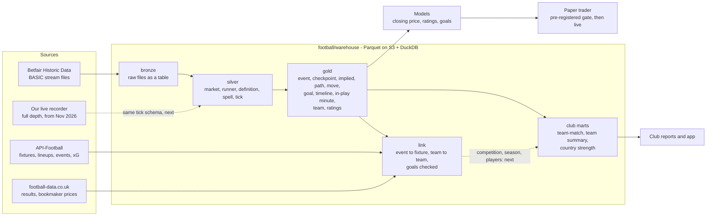

# racing² football data platform - architecture

One store of football data for two businesses: a quantitative betting model of Betfair's football markets, and
football analytics for clubs. This document is the end-to-end design, what is built, what it shows, and what
comes next.

Where the numbers come from. Unless a line says otherwise, every figure is from the warehouse in the capture
bucket as built from the owner's 2026 Betfair download by GitHub run 43112672668 (11 Nov 2026), and is one of:
a query of `python -m football.warehouse facts`, a line of the quality report (`check`), a line of the link's
report, or the output of the module named. Figures marked *local* were measured on the same files on the build
machine (which holds API-Football's goal events for 22 divisions); the local build and the bucket's agree on
every table's row count and on the model's and the efficiency study's every number. Figures marked *reviewer*
are an independent reviewer's own count. Table and column definitions: `docs/football_data_dictionary.md`
(generated from the code's contracts).

## 1. At a glance

| | |
|---|---|
| Raw data in | 165,734 Betfair market files (match odds, over/under 2.5, Asian handicap; every country; Jan to early Nov 2026), 0 unreadable |
| Matches | 55,015 (52,635 went in play; 53,530 settled with a result) |
| Price updates | 26,486,634 (9,929,395 before the off, 16,553,814 in play), each stamped with the market's state and clock |
| Teams | 10,053 Betfair team ids; 3,193 ranked on a market-implied strength scale |
| Linked | 50,823 matches (92.4%) tied to an API-Football fixture; the settled result agrees with the fixture's score on 50,380 of 50,386 |
| Tables | 25: 2 bronze, 5 silver, 12 gold, 3 link, 3 club (section 5) |
| Build | 15 minutes on one GitHub runner for a full rebuild from bronze with the link, the checks and the models (run 43104131683); 6 when nothing has changed (run 43112672668) |
| Checks | quality report: 50 checks, 0 failed; 175 unit tests, run on every pull request; two rounds of independent review by seven reviewers, every defect reproduced before it was fixed (section 8) |
| Engine | Parquet on S3 (or a local folder) + DuckDB; no server, no new monthly cost |
| Run it | `python -m football.warehouse ingest-queue`, `build`, `check`, `facts`; or the workflow |

## 2. What each business needs

**Betting.** The closing price is the benchmark: a bet that beats it has positive expected value before costs.
The model must forecast the move from any earlier moment to the close, on Betfair's own prices, and know how far
to trust each price (a last traded price can be hours old). It needs point-in-time data: at a decision made 60
minutes before kick-off, only what was published by then, measured from the kick-off time known then.

**Clubs.** The market is the best available estimate of how good a team is; results are noisy samples of it.
From the same prices: each team's strength on one scale, results against expectation, how a match went minute
by minute, the gap between leagues, and (with API-Football's lineups and events) what the market thinks of a
team with and without a player.

Both need the same foundation: every price, typed and trustworthy, tied to matches and teams.

## 3. End to end

Bronze is immutable and everything else is rebuilt from it. A build is idempotent: a partition is rebuilt only
when the fingerprint of its inputs or the code's version changed, and the quality report fails the run if any
table is left behind its inputs.

## 4. Decisions

| Decision | Choice | Why | Not chosen |
|---|---|---|---|
| Storage | Parquet on S3, hive-partitioned by year and month, one file a partition, sorted by key, zstd | Already our store; columnar; cheap; any tool reads it | A database server to run and pay for |
| Engine | DuckDB 1.5.6 (pinned) over the files in place | SQL, window functions, hundreds of millions of rows on one machine, no server | ClickHouse, QuestDB, Timescale: not needed at this size (ten years is about 265 million price rows, 2 GB) |
| Table format | Plain Parquet + a manifest a table (rows, bytes, input fingerprint, code version) | One writer (the workflow); rebuilds are cheap and exact | Iceberg, Delta, S3 Tables: weight without a second writer. DuckLake is the upgrade path if a second writer or time travel is ever needed |
| Raw files | As rows of a table (`bronze/raw`: path, hash, bytes) | No small-files problem (165,734 files become 11 objects); hashed; queryable | 165,734 loose objects in S3 |
| Partition key | The date in the file's own path (the day the market settled) | Bronze, silver and gold line up one to one; incremental builds are trivial | Kick-off month: 0.4% of markets settle in another month |
| The clock | Checkpoints are minutes before the kick-off time as it stood before the off, with a flag where that schedule was not yet set (section 6) | Training matches what a trader would have seen | Betfair's last `marketTime`: rewritten to the actual kick-off on one market in eleven |
| Prices at checkpoints | The last price at or before the moment, with its age and its book | A stale or partial book is a column, not a surprise | Interpolation |
| As-of joins | `pandas.merge_asof` on integer keys | 4 seconds a month; DuckDB's ASOF JOIN took 6 min 47 s on the same input (it partitions the whole lookup side) | DuckDB ASOF JOIN, until re-tested on 2.0 |
| Transform code | Small modules, each a pure function of Arrow tables (`SPECS`, `INPUTS`, `VERSION`, `build`) | Testable without a store; the orchestrator does I/O, order and manifests | One large script |
| Team identity | Betfair's selection id of the match-odds runner | Stable across competitions | Names (223 ids carry more than one spelling) |
| Dependencies | The warehouse's pins in `football/warehouse/requirements.txt` | `requirements.txt` is installed by the live horse-racing jobs; nothing built for football may change their environment | Adding pins to the shared file |
| Bundle links | From the `FOOTBALL_BUNDLE_URLS` secret, checked against the bundle's size and SHA-256 | The repository is public and the data is licensed to its buyer | A link in the repository (section 12) |
| Serving to clubs | Later: versioned, pre-aggregated Parquet read by DuckDB in the app | Needs the owner's approval for any cost | Aurora now |

Aurora Serverless v2 is not used: nothing here needs a server yet, and it would cost money each month.

## 5. The data model

Conventions: times UTC; prices are Betfair decimal prices; `handicap` is 0.0 where a runner has none, so
(market, selection, handicap) is always a full key.

| Layer | Table | One row is | Key | Rows (2026) |
|---|---|---|---|---|
| bronze | `bronze/raw`, `bronze/index` | a raw file (with / without its bytes) | plan_path | 165,734 |
| silver | `silver/market` | a market, with its clock | market_id | 165,734 |
| silver | `silver/runner` | a runner (selection and line) with its result and closing price | market_id, selection_id, handicap | 3,922,641 |
| silver | `silver/definition` | a publication of the market's state | market_id, seq | 4,542,972 |
| silver | `silver/spell` | a run of constant (in play, status) | market_id, spell_no | 1,138,925 |
| silver | `silver/tick` | a published last traded price, with the state then | market_id, selection_id, handicap, pt, seq | 26,486,634 |
| gold | `gold/event` | a match: sides, kick-off, result, trading, closing 1X2 | event_id | 55,015 |
| gold | `gold/team` | a Betfair team | team_id | 10,053 |
| gold | `gold/checkpoint` | a runner at a checkpoint: price, age, book, whether the schedule was known | market_id, selection_id, handicap, cp_min | 9,759,985 |
| gold | `gold/implied` | a match at a checkpoint: chances, goal expectancies, draw premium, handicap against 1X2 | event_id, cp_min | 602,728 |
| gold | `gold/path` | a runner's price path before a checkpoint (37 features) | market_id, selection_id, handicap, cp_min | 1,011,383 |
| gold | `gold/move` | a runner's move from a checkpoint to the close (the model's target) | market_id, selection_id, handicap, cp_min | 6,259,743 |
| gold | `gold/goal` | an inferred goal: minute, side, score after it, evidence | event_id, goal_no | 137,451 |
| gold | `gold/timeline` | a match's inferred timeline and how far to trust it | event_id | 52,635 |
| gold | `gold/inplay_minute` | a match at a minute in play: the three chances, their quality, the score | event_id, minute | 6,105,455 |
| gold | `gold/inplay` | a match's in-play summary: expected points averaged over the match, against the pre-match ones | event_id | 52,630 |
| gold | `gold/team_rating` | a team before and after a match: market-implied attack, defence, strength, tempo | team_id, event_id | 110,018 |
| gold | `gold/rating_gap` | a match at a checkpoint: what the ratings imply against the price | event_id, cp_min | 263,395 |
| link | `gold/link` | a match and its API-Football fixture (competition, season, score) | event_id | 55,015 |
| link | `gold/team_link` | a Betfair team and its API-Football team | team_id | 10,053 |
| link | `gold/goal_check` | a linked match: inferred goals against real goal events | event_id | 49,602 |
| club | `club/team_match` | a team in a match: expectation, result, performance, luck, ratings | team_id, event_id | 110,018 |
| club | `club/team_summary` | a team: its matches added up, its rating, its rank | team_id | 9,825 |
| club | `club/country_strength` | a country and category: how strong its sides are | country_code, category | 251 |

What the silver layer keeps that the old tables dropped: every price (not four marks), the market's state at each
price, every state change, and the in-play half of the data (62% of all price updates).

## 6. The market's clock

Three things in Betfair's files must not be taken at face value. The first review round found all three in the
first build of these tables; the parser now handles each, and each has a test built from a real case.

| Trap | How often (2026) | What went wrong | What the warehouse does |
|---|---|---|---|
| The kick-off time is rewritten at the kick-off | 15,245 of 165,734 markets | A checkpoint grid measured from the rewritten time holds prices published after the checkpoint (6.3% of T-5 rows in the first build) | `market_time_pre`: the schedule as it stood before the off; `schedule_known` on every checkpoint row says whether that schedule had been set by then (98,200 of 8,432,821 rows had not) |
| The in-play flag can be wrong | 41 markets turned in play more than once | A turn made a day early by mistake made the "close" a price from the day before; a drop out of play in mid-match made in-running prices a close | `in_play_pt` is the turn nearest the kick-off time in force when it was made; a price is in play from that message on |
| Some markets never turn in play and trade through the match | 7,813 markets; 883 traded after their scheduled kick-off | In-running prices were read as the closing price | `off_pt`: the turn in play, else the scheduled kick-off; `silver/tick.pre_off` |

A fourth cannot be put right from the files and is flagged instead: where Betfair turns a market in play late,
the prices just before the turn are in-running. Such books usually fail a consistency test (no single
Dixon-Coles market could make them: `gold/implied.rho` is blank, 67 closes), and a close that fails it
is kept out of the ratings.

## 7. Identity and linking

- **Event** = one match (Betfair's event id). 54,970 of 55,015 events have all three markets. Where an
  event has two markets of one type, the one that traded more is the event's.
- **Team** = the selection id of the side on the match-odds market: one id in every competition. Known limits:
  a few ids cover two clubs of one name (13 ids with low agreement in the link), and 159 names are
  spread over more than one id (review round one).
- **Competition and season** are not in the BASIC files (only a country code, missing on 5,641 events: cups
  and internationals). They come from `football/warehouse/link.py`: events are tied to API-Football fixtures by
  kick-off and team names, then team ids are mapped by majority vote and the rest linked through the map, with
  the settled result and over/under as vetoes.
- **Link result** (run 43112672668, 273,019 fixtures): 50,823 of 55,015 events linked (92.4%):
  exact names 25,842, team anchor 19,003, team map 5,466, fuzzy 511. The settled result
  agrees with the fixture's score on 50,380 of 50,386 and over/under 2.5 on 50,383 of 50,387. The 8 links
  that disagree with a settlement are exact-name links, which are never vetoed: mostly awarded results, one
  doubtful (*reviewer*). A reviewer attacking the link could produce no wrong link that survives where both
  sources hold a result. 7,735 of 10,053 team ids are mapped to an API-Football team.
- **Category**: senior, women, youth or reserves, read from the sides' names (approximate: senior 47,231, reserves 3,007, youth 2,829, women 1,948).

## 8. Quality, review and operations

- `python -m football.warehouse check` exits 1 on a failed hard check. Hard checks: silver built from the current
  bronze by the current parser; gold built from its current inputs; files in = read + unreadable + superseded;
  keys unique (market and event ids across partitions too); every row's market exists; no checkpoint carries a
  price published after its moment; every checkpoint on its grid; the event's closing 1X2 equals the checkpoint
  table's close; a complete book's chances sum to one; implied totals and supremacies in range.
- On the 2026 data: 50 checks, 0 failed. Closing chances against results on 42,928 matches with a fresh
  full book: home 0.4376 against 0.4360 realised, draw 0.2481 against 0.2503, away 0.3143
  against 0.3137.
- Independent recount (review round one): all 165,734 raw files re-read by a separate minimal parser:
  19,294,729 lines, 3,922,641 runners, 26,486,634 price updates: every market count, runner price, time, status
  and price update identical to silver. Bronze against the zip: all 165,734 hashes equal.
- Two rounds of adversarial review (seven reviewers; each had to reproduce a defect on the 2026 files before
  reporting it, and each fix has a test that failed before it). Round one (ingest, the core tables, the maths,
  the model and operations) found and this build fixes: the three clock traps of section 6; checkpoints after a
  market closed; the handicap read without the draw correction (a bias of about 0.05 goals with the line's
  sign); a stale handicap main line; a silver partition not rebuilt when another month superseded one of its
  files; a bronze write that could die half way and stay wrong; no check that gold was current; casts that
  could change a value quietly; a workflow step that hid a failed build behind `tee`; pins that would have
  reached the live horse server; and a download link in a public repository (section 12).
- Round two (goals and in-play, ratings and club, the link) found and this build fixes: a consistency rule
  that dropped 31% of closes with a total over five goals from the ratings; a side back after more than the
  rating window shown with its opponent's rating as its own (cannot happen within one year; would at ten);
  goal lists never checked against the moment the over/under market stopped, which is the third goal (2,523
  usable matches fail it, and their scores were right on 48 of 110: they now carry no reliability and give no
  club score); a goal with no known scorer passing every check; minutes whose three prices belong to two
  scores marked sound; the over 2.5 chance standing after its market's last suspension; rankings that mixed
  ratings from different days of a drifting scale (now one solve); club pools joined by matches that rate
  nobody; the performance measure's lean against strong sides; the link's goal-check accuracy overstated;
  and the model's trade table in log-price units where cash on the money at risk is a fifth of it (10.2).
  Withdrawn rather than patched: the club table's re-rating columns (section 11).
- The model's harness, re-run by a reviewer from its own code: the headline to four decimals; a placebo target
  scores -0.10% (-0.24 to 0.04); a planted leak (the closing chance as a feature) scores 0.89, so the harness sees a leak
  when there is one; no training label closes after a test decision in any of the seven folds; tables rebuilt
  from ticks cut off at T-60 are identical at every checkpoint from T-60 back; ratings rebuilt with every
  later close removed are identical on every earlier row.
- Tests: `tests/test_football_warehouse*.py`, `tests/test_football_bf_*.py`: 175 tests, hand-written
  stream files through the real parser, exact values. `football-tests.yml` runs them and the workflow guards on
  every pull request that touches them.
- Workflows: `football-warehouse.yml` (its own workflow once merged) and the `warehouse` job of
  `football-research.yml` (GitHub's runners, S3 only, nothing reaches Betfair). Run one at a time: both write
  the same tables, and the job in `football-research.yml` should be retired once the first is on the default
  branch.
- The research ledger (`reports/research_ledger.jsonl`) holds a line for each model read of this build
  (tags `football-bf-efficiency-1111`, `football-bf-close-model-1111`, `football-market-ratings-1111`,
  `football-goal-inference-1111`), written after the runs: the ledger's rule reached this branch when the
  default branch was merged in.

## 9. Metric catalogue: what is engineered from the data

**Built** means in a table, tested and run on 2026. *Planned* items are ranked in section 10.

| Family | Metrics | Table | Betting use | Club use |
|---|---|---|---|---|
| Price level and trust | price, age, activity so far and in the window, book completeness, book sum, normalised chance, stalest leg, schedule known | `gold/checkpoint` **built** | the base of every target and screen | - |
| The move | log and logit move to the close, price ratio, quality of both ends, liquidity tier | `gold/move` **built** | the training target | - |
| Implied goals | total from over 2.5, supremacy from the 1X2 (both exact, independent of the low-score correction), each side's goal expectancy | `gold/implied` **built** | features; the base of in-play models | "market expected goals" for and against, every match in the world |
| Draw premium | the Dixon-Coles rho the draw price implies (median -0.086 at the close); blank when no market could make the books | `gold/implied` **built** | feature; draw pricing; a consistency test of a book | how low-scoring the market expects a match |
| Cross-market | the supremacy the handicap's main line implies against the 1X2's, read with the same rho (sd 0.061 goals at T-60 on fresh books) | `gold/implied` **built** | relative-value signal | - |
| Price path | 37 features: returns over six lookbacks, realised volatility, trend and its fit, range position, drawdown, jumps, deviation from the time-weighted price, last change, run length, tick imbalance, autocorrelation, implied spread (Roll), book catch-up | `gold/path` **built** | move forecast; separating bounce from signal | - |
| Move memory | each side's own earlier moves, the opponent's, the country's (strictly earlier closes) | model script **built** | move forecast | how the market treats a club |
| Market ratings | attack, defence, strength, tempo and their uncertainty for every team, one scale within a pool, point in time | `gold/team_rating` **built** | disagreement with the early price | true strength, league translation |
| Rating gap | ratings against the price at each checkpoint, in goals, log ratio and log odds | `gold/rating_gap` **built** | the Betfair-native version of our best feature | - |
| Inferred goals | goal minute, side, running score, evidence, confidence; time leading, level, trailing; whether the list agrees with the settlement and with the third goal's moment | `gold/goal`, `gold/timeline` **built** | in-play base; timing features | goal timing and game state where no event data exists |
| In-play path | the 1X2 chances each minute with a quality flag; time-averaged expected points; half-time chances; extremes; how far the chances travelled; the football minute the result was decided | `gold/inplay_minute`, `gold/inplay` **built** | in-play model base; late-game tests | win-probability chart of any match; how a match went beyond its result |
| Results against the market | points against expectation, split into performance (the run of play) and luck (the final whistle) | `club/team_match` **built** | form features worldwide | benchmarking |
| Standing | every side's strength from one solve; rank in country, category and pool; country strength | `club/team_summary`, `club/country_strength` **built** | - | league table of true strength |
| Closing efficiency | calibration of the close by selection, price band, liquidity, category, country | `football_bf_efficiency.py` **built** | where the close can be trusted | - |
| De-noised price | effective spread from serial covariance; a robust close | *planned* | a cleaner target | - |
| Lineup effect | the move around team news by who starts | *planned* (needs lineup times) | team-news model | what the market thinks of a player |
| League strength | country strength by division | *planned* (link is built; marts next) | - | league translation |
| Re-rating | how the market has changed its view of a club, against its own division | *withdrawn* until the back years and division ids (section 11) | - | who is improving |

## 10. Models and what they show

Standards: never scored on training data; features only from before the decision; a baseline for every model;
intervals from resampled match days; one year of data is development evidence, not a result to trade on.

**10.1 Is the closing price right?** (`football_bf_efficiency.py`, 47,088 matches with a fresh close.) Yes, to
the precision one year allows. Slope of results on closing log odds 0.992 (se 0.009, clustered by
match); backing every selection at its closing last traded price returns -0.12% (se 0.21) before
commission. No favourite-longshot bias by price band. This agrees with the largest published study (Whelan,
"Agreeing to Disagree: The Economics of Betting Exchanges", January 2026, karlwhelan.com/Papers/Betfair.pdf,
read in full: 200,622 Betfair matches, slope -0.0041 with se 0.0033 on the forecast error; takers lose 2.5%
 after commission, makers gain 0.6). The close is a sound target; beating it is hard.

**10.2 Can the move to the close be forecast from Betfair's own prices?** (`football_bf_close_model.py`.)
One row a match-odds runner a checkpoint (360, 120, 60 and 15 minutes before the scheduled kick-off); the target is the move of its chance to the close, in log odds; features are what was known at the checkpoint; ridge and LightGBM, walk-forward by month (2026-04 to 2026-10 forecast from earlier matches only); scored against "no move" on 140,949 reliable rows over 214 match days, intervals from resampled days.

| Features | Skill against no move | 95% interval | Added to the level features |
|---|---|---|---|
| Level only (price, book, activity, time) | 0.81% | 0.54 to 1.11 | - |
| + price path (37) | 2.04% | 1.58 to 2.50 | +1.22 (+0.84 to +1.60) |
| + implied goals and cross-market (9) | 2.05% | 1.67 to 2.44 | +1.23 (+0.99 to +1.49) |
| + market ratings against the price (26) | 2.16% | 1.74 to 2.59 | +1.35 (+1.04 to +1.67) |
| + move memory (6) | 1.16% | 0.85 to 1.49 | +0.35 (+0.17 to +0.52) |
| **All families** | **3.47%** | **2.96 to 4.00** | +2.66 (+2.23 to +3.14) |

Where the skill is, by how much the runner had traded by the checkpoint:

| Price updates by the checkpoint | Rows | Skill | 95% interval |
|---|---|---|---|
| under 20 | 66,326 | 3.84% | 3.23 to 4.50 |
| 20-59 | 48,085 | 3.42% | 2.42 to 4.37 |
| 60-149 | 18,860 | 2.14% | 0.82 to 3.55 |
| 150+ | 7,678 | -1.40% | -3.52 to 0.66 |
| The same model fitted on rows with 60+ updates alone | 26,538 | 0.57% | -0.75 to 1.80 |

By checkpoint: T-360 3.25% (2.44 to 4.13); T-120 3.54% (2.76 to 4.37); T-60 3.74% (2.74 to 4.68); T-15 3.52% (2.20 to 4.81).
By runner: away 3.45% (2.71 to 4.16); draw 7.66% (6.60 to 8.76); home 2.00% (1.40 to 2.62).
Large moves: 195 rows move more than 1 in log odds and carry 15.3% of the sum of squares; without them the skill is 3.50% (3.00 to 4.02).
Rows whose schedule was not yet set at the checkpoint (kept out of the headline): 1,665, skill -0.95% (-5.05 to 2.87).

Trades at last traded prices (an upper bound: a last traded price is not a quote), a unit staked a bet: back at the checkpoint and lay at the close where the forecast says the chance rises, the reverse where it falls; net of a 2.3% round trip and 2% commission; forecasts of at least 0.05. The move captured is in log price; the cash column is what the hedged trades won over the money they put at risk (a back's stake; a lay's liability):

| Price updates by the checkpoint | Bets | Backs / lays | Move captured, log price x 100 (90% interval) | Cash on the money at risk (90% interval) | Right way |
|---|---|---|---|---|---|
| under 20 | 8,512 | 2,874 / 5,638 | +3.54 (+3.12 to +3.98) | +0.87% (+0.60 to +1.15) | 61.7% |
| 20-59 | 2,731 | 965 / 1,766 | +2.80 (+2.18 to +3.39) | +0.39% (+0.27 to +0.51) | 62.2% |
| 60-149 | 643 | 223 / 420 | +2.23 (+0.87 to +3.67) | +0.20% (+0.01 to +0.38) | 59.9% |
| 150+ | 228 | 82 / 146 | -0.65 (-2.03 to +0.78) | -0.11% (-0.28 to +0.04) | 49.6% |
| All | 12,114 | 4,144 / 7,970 | +3.22 (+2.90 to +3.57) | +0.66% (+0.48 to +0.85) | 61.5% |
| Busy-rows model, 60+ updates | 944 | 415 / 529 | +0.47 (-0.55 to +1.46) | +0.00% (-0.13 to +0.13) | 55.5% |

Median price laid: 5.6; cash a unit staked +3.37%.

Gain share in the last fold by family: level 11%, path 43%, implied 15%, rating 23%, memory 8%; leading features: `imp_rho` 7.6%, `path_last_dx` 7.6%, `cp_min` 3.3%, `cp_book_sum` 3.0%, `path_x` 2.7%, `rate_mk_p_draw` 2.6%, `path_jump_abs_2h` 2.3%, `path_ret_2h` 2.1%.

Reading. The forecast beats "no move" and every family of features adds to it, the market ratings most. But
the skill is where a runner has barely traded: in a thin market the last traded price is a noisy reading of the
price, and most of what can be forecast is that noise correcting itself (the draw, the least traded runner, is
where it is largest, and it is negative on busy draws). On rows with 150 or more price updates there is none,
and a model fitted on busy rows alone has an interval that spans zero. The trade table is an upper bound for
the same reason (a last traded price is not a quote), and its cash column is the one to read: of the 12,114 trades at the 0.05 threshold 7,970 are lays, at a median price of 5.6, where the money at risk is the liability; the move captured is +3.22 in log price x 100, and the cash won is +0.66% of the money at risk (+0.48 to +0.85).
On one year of last traded prices there is no evidence yet of a tradable forecast in liquid markets. The test
that matters is at quotes (our recorder) and on the back years.

**10.3 Market-implied ratings** (`gold_rating.py`). Ratings built only from earlier closes forecast the next
closing rate ratio with R2 0.64 over all 25,234 matches of the even months, 0.82 where the less-seen side has 5
to 14 earlier matches, 0.84 with 15 or more, and 0.76 between sides of different countries (765 matches, both
sides with 10 or more): one scale across leagues, learned from cup and continental ties (*local*; constants
tuned on the odd months). A reviewer's independent dense re-implementation agrees to 2.5e-14, and changing
every rated close of one day changed no row stamped on or before it (*reviewer*). The scale holds within a pool of teams joined by matches: the
largest pool has 5,565 teams; women's football and many youth leagues are pools of their own. Strongest
senior sides in the last solve: Arsenal 3.13, Barcelona 3.12, Bayern Munich 3.06, Man City 3.02, Real Madrid 2.99, Inter 2.78, Paris St-G 2.77, Liverpool 2.67, Atletico Madrid 2.63, Chelsea 2.63, Benfica 2.63, Brighton 2.61. Strongest countries by their five best sides: GB 2.81, ES 2.64, IT 2.52, DE 2.52, FR 2.16, PT 2.15, NL 2.00, TR 1.95, SA 1.88, BE 1.81. Limits a
user must know: a league joined to the rest by few matches has its level shrunk towards the centre (8 countries
and 96 ranked sides have under one match of weight tying them in), and one match listed under a wrong id can
tie two pools (in 2026 a women's match under a men's id: event 35345397) (*reviewer*).

**10.4 Goals from prices** (`gold_goal.py`). Betfair's files carry no score; goals are inferred from the three
markets' in-play moves and reconciled with the settlement. Held-out months, usable matches: the final score is
exactly right on 94.4% of 2,681 matches with API-Football goal events and 94.1% of 4,201 with
football-data.co.uk scores (*local*; a reviewer's own count on the first sample before the last fixes: 94.3%
 of 2,677); across every linked league, 92.9% of 38,758 usable matches. Goals are
found with recall 0.90 and precision 0.96 within four minutes, the scoring side is right on 99% of
paired goals, and the minute is within a median 0.5 (*local*). Within two football minutes recall is 0.81 and
precision 0.86 on the 22 divisions held locally (*local*), and 0.70 and 0.76 across every linked
league (the link's goal check, usable matches; how complete API-Football's goal events are in the lower
leagues is not measured, and a missing event counts against the inference). 76.7% of in-play
matches are usable, and they are not a fair sample: a one-sided match stops trading, so 96% of matches
that ended level are usable and 22% of those won by four (*reviewer*). A list also says whether its
third goal is where the over/under market stopped (`agrees_third`): 2,523 (*local*) usable lists are not, and
carry no reliability. Weak spots: matches of five goals (72% exact) and six or more (52%), where
a goal each side late on goes unseen (*reviewer*); 12,093 goals with no minute; and a red card can read
as a goal (at most 7% of red cards).

**10.5 The match minute by minute** (`gold_inplay.py`). The in-play chances are calibrated against results at
every minute checked (minute 15: home 0.4443 against 0.4422 realised, 34,100 matches; minute 75: home 0.4300 against 0.4289 realised, 38,743 matches; minute 105: home 0.3845 against 0.3859 realised, 38,177 matches). A reading is trusted when its three prices are of one moment: none stale,
and none from before the match's latest goal. The time-averaged in-play expected points less the pre-match ones
averages -0.008 for home sides and +0.005 for away sides over 48,513 matches, against a standard
deviation of 0.55. The reading is close to a fair price, not exactly one: late in a match the last
traded prices read the side ahead about a point of chance low (0.95 read, 0.96 won: the legs that have stopped
trading carry prices from before the lead was safe), which leans the raw difference against strong sides
(-0.04 points a match at a win chance over 0.7, +0.03 under 0.1; *reviewer*). The club marts measure
performance from that lean's line (section 11).

**10.6 What to build next for the betting model**, in order (evidence in `reports/football_model_rethink.md`):
1. The back years (2016-2025). One year cannot separate a 1% effect from noise in busy markets. The
   model script needs reshaping first: at ten years its frame would need about 22 GB and a monthly walk-forward
   many hours (*reviewer*'s extrapolation from one year), against 16 GB and a five-hour limit on a runner.
2. A quote-level test at our recorded books: BASIC history has last traded prices only, and the forecastable
   part of a last traded price is mostly not tradable (10.2).
3. Maker-side execution: the published evidence is that takers lose about the cost and makers do not.
4. A de-noised price and a robust close (median of the last prints; effective spread from serial covariance).
5. Team news: the move around the lineups, by who starts, once lineup publication times are held.
6. Two-stage model plus market (Benter): each signal as an out-of-fold forecast, the price now as the offset.
7. In-play: a model calibrated to the kick-off prices, stepped at inferred goals; late-game longshot tests.

## 11. Club analytics

**What is built.** `club/team_match` (one row a team a match), `club/team_summary` (one row a team) and
`club/country_strength`, on the ratings, the in-play table and the inferred timelines.

**Three measures of a result**, in order of noise: points against the pre-match expectation; *performance* (the
match's average in-play expected points against the pre-match ones: how the match went, every minute counting);
*luck* (the rest of the result's surprise: what the final whistle gave beyond the run of play). They add up
row by row. Over 105,664 team-matches points against expectation average -0.0009 (se 0.0036): the
expectation is fair. Performance is measured from a line in the pre-match expectation, because the raw
in-play reading leans against strong sides (10.5): the line was fitted on the odd months, and on the even
months what is left is within 0.02 points of zero at every level of expectation (six bands of expected points, 49,134 team-matches: raw +0.027 at the lowest to -0.044 at the highest; from the line -0.017 to +0.013).

**What the data says a club should read.**
- A team's later points go with what the market expected of it so far, not with its points so far: over
  1,436 teams with 30 or more matches, the correlation of second-half points with first-half expected
  points is 0.47 against 0.36 with first-half points; with both in one regression the weight on points
  so far is 0.01 and on expected points 0.63. The league table adds nothing the price did not know.
- Performance and luck against the market do not persist (correlation of the first half of a team's matches
  with the second: +0.01 and +0.01; across 2,067 teams the spread of performance a match is no wider
  than chance alone gives, *reviewer*). They describe a run of matches; they are not ratings, and sides are not
  to be ranked on them. A club's level is its strength.
- Every ranked side's strength is from one solve, the day after the last close held (3,193 sides ranked),
  so a rank compares like with like.
- How a club's rating has changed over the year is not in the table. A first build had it, and the review
  showed what it measured on one year: for one ranked side in five the first rating was taken while its league
  was still a pool of its own (a change of scale, not of the club), and for the rest half the variance was the
  division's (every Premier League and Serie A side "up"), because the level between divisions is still being
  learned through a first year. It returns with the back years, read against the side's own division.
- Inferred scores are not added up by team: a score can be inferred only where the match traded through to the
  end, which one-sided matches often do not, so matches with a score are a biased sample of a season.

**Products this supports** (ranked by feasibility with our data; research notes of 11 Nov 2026):

| # | Product | Ready | Caveat |
|---|---|---|---|
| 1 | Global club rating and league strength index | ratings and country strength built; division level needs the link's competition ids in the marts | a consensus view; cross-league links rest on few cup ties; a thinly linked league is pulled to the centre |
| 2 | True strength against the table | built at team level | says how good and how the results fell, not why; not a forecast beyond the price |
| 3 | Season simulation (promotion, relegation, Europe) | needs competition rules and remaining fixtures | rules hand-coded per league |
| 4 | Head-coach spell evaluation | needs coach history from API-Football lineups | the market prices the manager in: it measures surprise |
| 5 | Game-state and goal-timing profile | built (`gold/goal`, `gold/inplay_minute`) | inferred, 94% exact on usable matches; one-sided matches under-represented |
| 6 | Fixture difficulty, squad age and availability, loan destination matching | need player tables from API-Football | no contract, wage or transfer data held |
| - | Set pieces, style, recruitment on actions | not feasible | needs event or tracking data we do not hold |

## 12. Licensing and exposure: read before anything is sold

1. **Betfair data for commercial use.** Read on 11 Nov 2026: Betfair's licence page lists licences for personal
   betting, software vendors, betting operators or companies using Exchange data (through Flutter's data
   services team), white labels and odds publishers
   (support.developer.betfair.com/hc/en-us/articles/360002464152-Which-API-Licence-Do-I-Require); Flutter's data
   services page says partners must obtain a data licence from Betfair (flutter.com/b2b/data-services). Not
   verified (seen only as search extracts; the pages refused the fetch): that all commercial use of the data
   must be approved by Betfair (developer documentation) and that the general terms limit data to personal,
   non-commercial use. Not found: the purchase terms of the Historic Data (the site refused; they are in the
   owner's account) and any statement on data derived from prices (ratings, inferred goals). Our reading, not
   legal advice: the default is personal or internal use, and a consultancy selling club reports built on
   exchange prices fits none of the self-serve licence types. This is the largest open risk in the club plan:
   get a written answer from Flutter's data services team before the first sale.
2. **API-Football.** Its terms pages refused the fetch. Search extracts of them (unverified, and reported as
   about 600 days old) say that reselling the data is prohibited and that the provider grants no licence to
   publish it. Whether paid analysis derived from the data counts as resale was not found: ask in writing.
3. **The repository is public.** Until this build the list of bundles carried the direct download link of the
   2026 files (commit 530bb9e on this branch); `sources/betfair_imports.json` and `au-historic.yml` on the
   default branch carry links to other bundles. Anyone with a link can download licensed data. This build
   takes the warehouse's link out of the repository (a secret holds it), but the old commit still shows it.
   Owner's actions: turn off link sharing on those Drive files (or move them); decide whether the repository
   should be private; then the links in the other two files can be moved to secrets the same way.
4. **Personal data.** Player-level products (ratings, injuries) are personal data under UK GDPR; none is built.
5. **Betting and club work under one roof** needs a firewall design (team news is inside information).

## 13. Roadmap and owner decisions

1. **Ingest 2016-2025** as the download finishes: one entry a bundle in `football/warehouse/bundles.json` (name,
   size, SHA-256) and its link in the `FOOTBALL_BUNDLE_URLS` secret; the workflow does the rest. Ten years is
   about ten times this build if the earlier years hold as many matches (not known): 2026 is 1.7 GB of tables
   (*local*), so of the order of 20 GB in the bucket and an hour or two on a runner.
2. **Division-level marts** from the link (competition, season): league tables of true strength, league
   strength, and the change in a club's rating against its division (withdrawn from this build: section 11).
3. **Unify the live recorder** into the same tick schema (depth and volume the BASIC files lack).
4. **Freeze and pre-register** a closing-price model only if it clears the gate on the back years at quotes.
5. **A first club report** from the marts, once the licence question has an answer.
6. **Decisions for the owner**: the Drive links and the repository's visibility (section 12); a licence
   conversation with Betfair; whether to buy the ADVANCED plan for a sample period (volume and depth in history);
   merging PR 288 (the warehouse workflow can be dispatched on its own only from the default branch; the pull
   request touches paths the code owners file reserves for the owner: three workflow files, one added guard in
   `tests/test_workflow_guards.py`, and `CLAUDE.md`).

## 14. Known limits

- One year of data: every model number is development evidence.
- BASIC files: last traded prices about once a minute; no quotes, volume or depth. A late turn in play cannot be
  told from a late kick-off (flagged by the consistency test of a close's books, not removed).
- Ratings compare within a pool only; a team's first matches and a league's first cross-league ties are noisy;
  a thinly linked league is shrunk towards the centre and nothing on the row says so yet; one match under a
  wrong id can join two pools.
- Inferred goals: 76.7% of in-play matches are usable, fewer the more one-sided the match;
  high-scoring matches are the weak spot; an early goal cannot be told from a late turn in play. The handicap
  ladder is taken to reach the margin (every 2026 ladder runs from -4 to +4; another year's may not).
- In-play chances read a side that is well ahead about a point low; minute rows are last traded prices as of
  the minute. A market closed and reopened ends its grid at the first close (7 summaries of cut matches).
- The model's trade table is at last traded prices: an upper bound, not a result.
- Categories are read from names; a cup tie between a first team and a reserve side is labelled reserves.
- 32 matches appear under two Betfair event ids (3 of them counted twice in the club tables); a few team ids
  cover two clubs (4 ranked sides are such blends).
- The link: an exact-name link is kept even where the settlements disagree (8 of 25,650: awarded results
  mostly); the fuzzy and team-anchor passes cannot be checked where neither source holds a result.
- Not yet run at ten years: the ratings take about 3 minutes and 3 GB there on tiled data (*reviewer*); the
  model script will not fit a runner as it stands (10.6).
