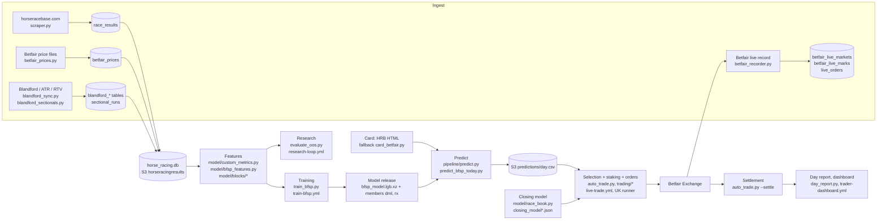

# racing² horse racing pipeline - Phase 0 map (18 Nov 2026)

Scope: UK/IE horse racing only (the owner, 18 Nov 2026: "ignore greyhounds here. just horse racing"). Every entry names
the script and the job that runs it; table row counts are from `research/queries/phase0_data_audit_1118.py`
(research-query runs 44331024155 and 44332233719).

## Stages, scripts and jobs

| Stage | Script(s) | Job (schedule, UTC) | Writes |
|---|---|---|---|
| Results ingest | `scraper.py` (HRB CSV export + HTML; not read here: it holds the account email) | `daily-results.yml` (21:30) | `race_results` (2,023,508 rows, 2010-01-01 to 2026-11-16) |
| Betfair price files | `betfair_prices.py --archive` / `--pull-s3 --load --match` | `betfair-prices.yml` (22:30, UK runner), loaded in `daily-results.yml` | `betfair_prices` (2,146,291 rows, 2017-12-31 to 2026-11-16), `betfair_prices_files` |
| Live market record | `betfair_recorder.py --record` / `--load-db` | `live-trade.yml`, `live-record.yml`, loaded in `daily-results.yml` | `betfair_live_markets`, `betfair_live_marks`, `live_orders` (from 2026-09-30) |
| Sectionals and Timeform-feed data | `blandford_sync.py`, `blandford_sectionals.py`, `scripts/build_sectionals.py` | `blandford-sync.yml` (06:45), `blandford-sectionals.yml` (00:20) | `blandford_results`, `blandford_atr`, `blandford_rtv`, `sectional_runs`, `data/external/sectionals.csv.gz` |
| Database backup | `backup_to_s3.py`, `scripts/fetch_data.py` | in the jobs above | S3 `horseracingresults/horse_racing.db` (3.15 GB) |
| Features | `model/custom_metrics.py` (`CustomMetricsEngine`), `model/bfsp_features.py` (`PRODUCTION_BLOCKS`), `model/blocks/*.py`, `model/feature_cache.py` | inside training, research and prediction | 1,181 served features (`data/models/bfsp_model_meta.json`) |
| Training | `train_bfsp.py`, `scripts/verify_model.py` | `train-bfsp.yml` (manual) | release: `bfsp_model.lgb.xz`, `bfsp_model_meta.json`, members `dml`, `rx` (`bfsp_ensemble.json`) |
| Research evaluation | `evaluate_oos.py`, `scripts/compare_oos_runs.py`, `scripts/clv_betfair.py`, `research/loop.json` | `research-loop.yml`, `research-query.yml` | out-of-sample predictions per fold, `reports/research_ledger.jsonl` |
| Prediction | `pipeline/predict.py` -> `predict_bfsp_today.py`; card fallback `card_betfair.py` | `predict.yml` (03:00), `predict-evening.yml` (00:10 UK) | S3 `predictions/<day>.csv` |
| Selection, staking, orders | `auto_trade.py`, `trading/strategy.py`, `trading/staking.py`, `trading/pricing.py`, `trading/risk.py`, `trading/exchange.py`, `trading/config_live.json`; closing model `model/race_book.py` | `live-trade.yml` (05:15, UK runner, real only with `TRADING_LIVE=yes`) | Betfair orders, `live_orders` |
| Morning models | `morning/select.py`, `morning/live.py` | `morning-models.yml` | Betfair orders (real only with `MORNING_LIVE=yes`) |
| Settlement and report | `auto_trade.py --settle`, `research/queries/done/day_report.py`, `pipeline/settle.py` | `live-trade.yml` (22:25), `trader-dashboard.yml`, `settle.yml` | settled P&L, `TRADING.md` |
| Controls | S3 `trading/STOP`, `trading/risk.py` | `trading-watchdog.yml`, `desk-warden.yml` (alert only) | stops, alerts |

## What the brief's stages map onto here

| Brief stage | Here | Note |
|---|---|---|
| Win model | LightGBM on the BFSP (target `logit_norm_prob`, huber), `model/bfsp_model.py build_target` | The owner kept the BFSP target (18 Nov) and added normalised beaten lengths (Phase 3) |
| Selection | the price now against the predicted BFSP, `min_move 0`, `max_price 200` | `CLAUDE.md` live-trading line, `trading/config_live.json` |
| Staking | GBP400 to win, GBP15-200 a horse, at most 5 top-ups, GBP4,000 a day | `CLAUDE.md`, `TRADING.md` |
| Execution | down the three best backs, each back laid at the SP (trade-out) | judged on CLV and Betfair's settled P&L, not the result |
| Experiment log | `reports/research_ledger.jsonl` (996 lines on 18 Nov), deflated Sharpe in `research/overfit.py` | `experiments/log.csv` will be written as a view of it |
| Locked holdout | race dates from 2026-04-01 (`scripts/research_loop.py EVAL_UNTIL`, `--lockbox-from` in `scripts/outcome_model.py` and `scripts/residual_screen.py`), not read in research; the served model itself is trained through 2026-11-12 (`bfsp_model_meta.json trained_through`) | opened once, in Phase 6 |
